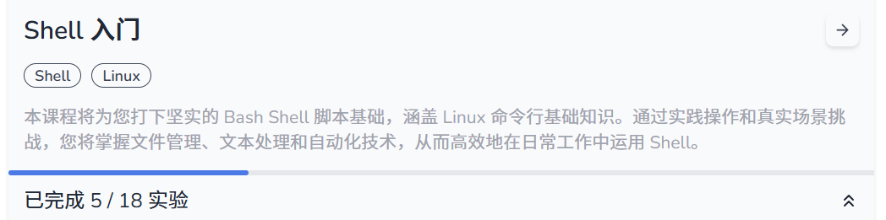
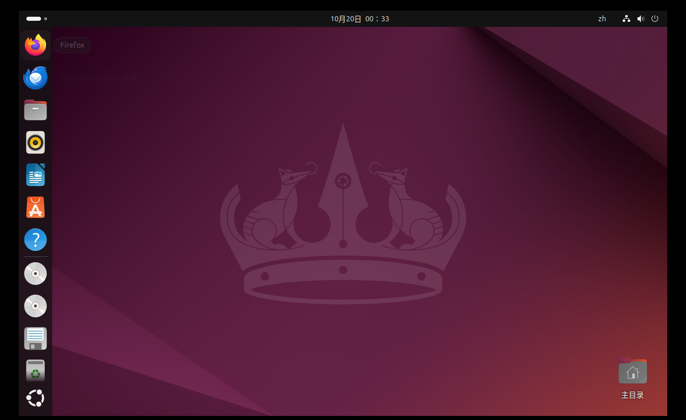
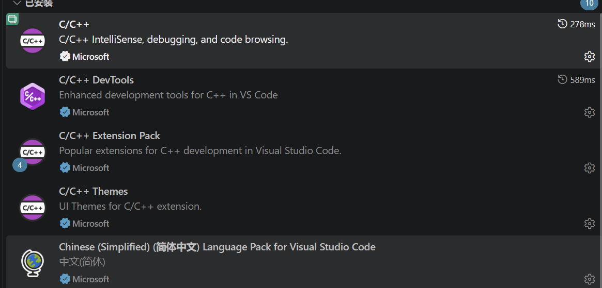
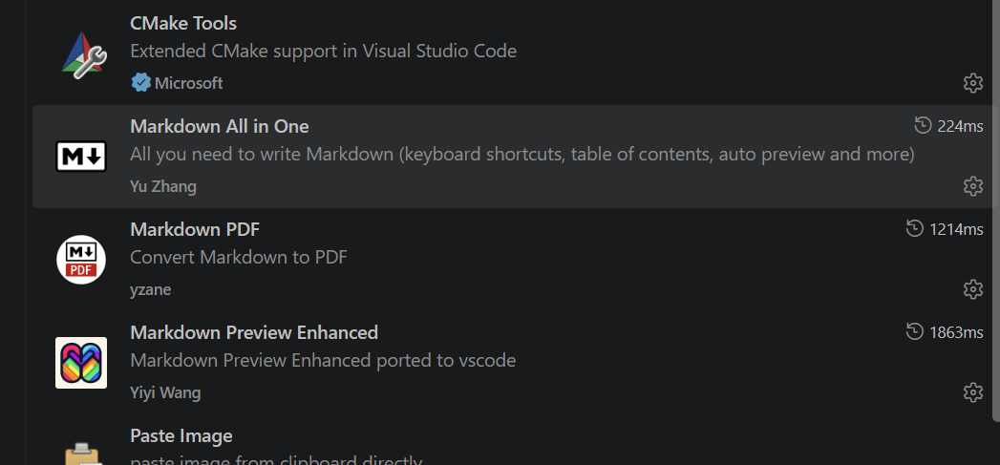
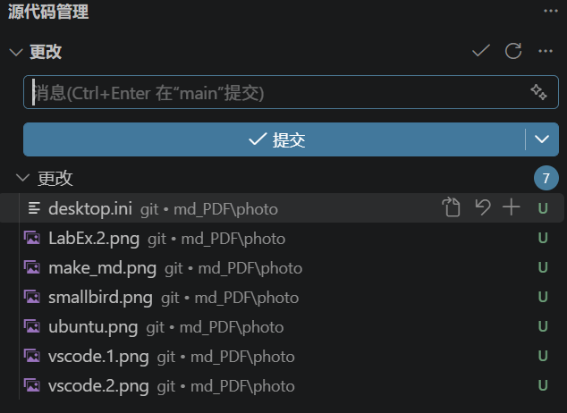

# <center><font face="仿宋">超算队考核技术报告</font></center>
---
**作者：haber-f**
## 一.基本情况概论
### 1.Linux基础入门
- 完成前三关，学习了第四关shell和第六关Linux账号部分知识，
- 通过LabEx平台学习Linux，共计完成15个实验

  
  
### 2.C/C++
- 完成前三关
- 参加雏鸟杯
  
## 二.环境的选择
### 1.NCUSCC的容器
~~不用开虚拟机了~~
- 非常方便快捷
### 2.DevC++
- 老软件依旧实用,负责修改进阶路线代码
### 3.VMware虚拟机
- 安装中文语言包
- 选择系统映像
>ubuntu-24.04.4-desktop-amd64
- 硬件配置（3GB内存，40GB盘，1处理器，2核）

### 4.VScode
- C/C++配置(MinGW-x64做编译器)

- Markdown配置(本篇md文档来源)

- git管理

## 三.考核过程
### 1.Linux第一题
>零基础小白与Linux的第一战——耗时2天半


- 学习方面
  1.课程学习  b站：只学够用的 Linux：长度正好的零基础入门教程——稍微对Linux命令有所了解
    b站：其他杂项，如虚拟机，Linux基础方面的。
  总结广而杂，无法付诸实践
  2.练习方面  通过千问推荐，综合比对，发现[labex](https://labex.io/zh/learn/linux)网站和[webminal](https://webminal.org/terminal/)适合用于Linux指令的练习，其中labex配备实时AI,利于即使提问(由于有clear机制，具体过程无法提供)
- 厘清脉络
由于对Linux任务不熟悉，由千问AI帮我厘清脉络
1.在 /workspace/目录下找到所有输入文件（如数据文件、密钥文本等）。
2.通过帮助信息明确 /workspace/exam 的用法、参数顺序及输入输出方式。
3.正确组合命令，将输入和密钥传递给程序。
4.确保生成的 /workspace/flag 与预期结果相同
- 代码实现
  找文件
```
bash-5.2$ ls -lah /workspace/
total 21K
...(大量文件)
```
看帮助
```
bash-5.2$ /workspace/exam -h
用法：exam [-h] -e 密钥

使用密钥处理 /workspace/input，将结果写入 /workspace/output。

选项:
  -h, --help  显示帮助并退出
  -e 密钥       指定非空 ASCII 密钥

诊断日志：/var/log/ncuscc/exam.log。退出码：0 表示成功，1
表示处理失败，2 表示参数错误或无法写入日志。
```


## 四.遇到的问题以及解决方案

